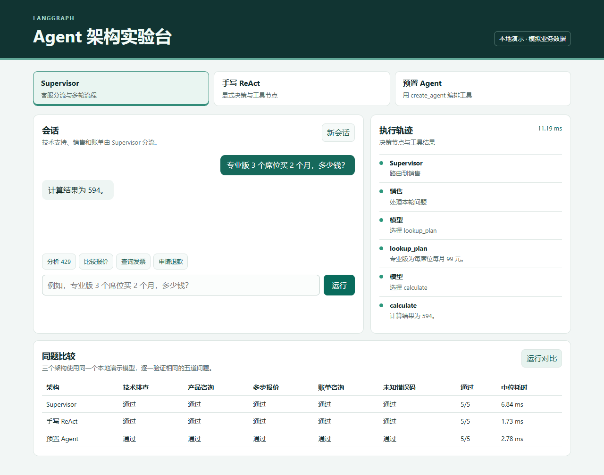
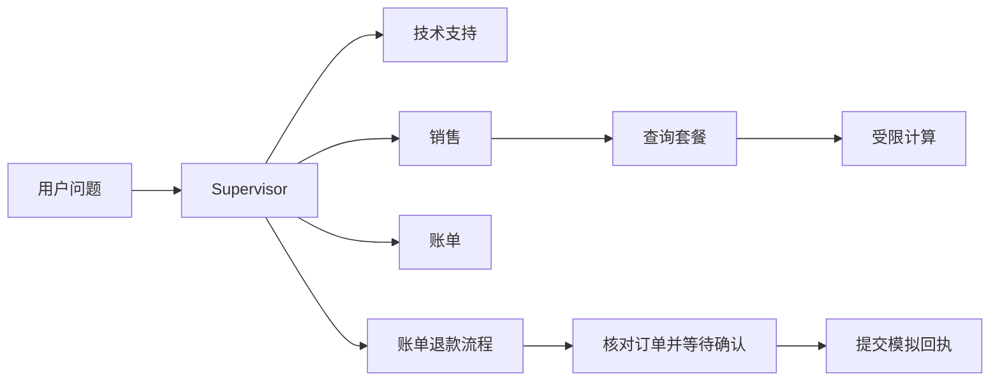

# LangGraph 多模式 Agent 实验台

把同一个客服问题交给三种架构，测试它们是否得到相同结果，并在浏览器查看模型决策、工具调用和返回值。



## 三种架构

| 模式 | 实现 | 适用场景 | 调整成本 |
| --- | --- | --- | --- |
| Supervisor | 统一路由到技术支持、销售或账单，各角色绑定对应工具。退款使用独立的确认流程 | 多角色分工、需要跨轮保存业务状态 | 新角色要增加路由规则、角色工具与回归用例 |
| 手写 ReAct | 用 `StateGraph` 定义模型决策、工具执行、反馈和终止条件 | 需要自己控制工具权限、预算和错误处理 | 每项执行规则由应用维护，可以检查每条边的行为 |
| 预置 Agent | 用 LangChain 的 `create_agent` 复用同一个模型和工具集，通过中间件限制调用次数 | 快速接入工具，沿用默认推理循环 | 组装代码较少，自定义逻辑放在中间件或工具层 |

对应入口为 [Supervisor](support.py)、[手写循环和预置组装](architectures.py) 与 [共同工具集](toolkit.py)。图结构与预置组件用法见 [LangGraph Graph API](https://docs.langchain.com/oss/python/langgraph/graph-api) 和 [LangChain Agent](https://docs.langchain.com/oss/python/langchain/agents)。



## 运行

需要 Python 3.12。从项目根目录执行。

```powershell
python -m venv .venv
.\.venv\Scripts\python.exe -m pip install -r requirements.txt
.\.venv\Scripts\python.exe -m uvicorn lab:create_app --factory --host 127.0.0.1 --port 8000
```

打开 [本地实验台](http://127.0.0.1:8000/)。默认使用本地确定性演示模型，套餐、订单和退款回执都是合成数据。会话与退款账本保存在当前进程内。

1. 在三种模式分别运行「比较报价」。销售工具返回每席位每月 99 元，再对 3 个席位、2 个月计算得出 594 元。右侧可以看每一步。
2. 在 Supervisor 中运行「申请退款」，选择演示订单 `ORD-1001`，中途查询发票，再确认退款。重新询问同一订单会返回已有回执。`ORD-1002` 用于演示人工复核分支。
3. 在任意单 Agent 模式运行「验证拒绝边界」，观察文件操作被表达式解释器拒绝。
4. 点「运行对比」，查看三种架构的用例结果与本次耗时。

从命令行执行固定用例和自动化回归。

```powershell
.\.venv\Scripts\python.exe lab.py --compare
.\.venv\Scripts\python.exe -m unittest discover -s tests -v
```

## 受限表达式工具

[expressions.py](expressions.py) 将输入解析为抽象语法树，再按白名单解释数字、四则运算及 `abs`、`min`、`max`、`round`。解释器限制输入长度、节点数、嵌套深度和数值范围。导入、属性读取和文件调用会被拒绝。它的用途是报价与算术演示。

## 验收结果

三种模式使用同一份合成数据和同一个本地演示模型，测试技术排查、产品咨询、多步报价、发票政策和未知错误码。每个用例同时核对答复要点与工具顺序。

| 模式 | 同题通过数 | 单次本地比较的中位耗时 | 多步报价轨迹事件数 |
| --- | --- | --- | --- |
| Supervisor | 5/5 | 7.69 ms | 6 |
| 手写 ReAct | 5/5 | 1.59 ms | 4 |
| 预置 Agent | 5/5 | 2.88 ms | 4 |

耗时反映本地进程中这五个用例的编排开销。Supervisor 的报价轨迹额外包含一次路由和一次销售角色处理。数值会随环境变化。

14 项自动化测试全部通过。浏览器验收覆盖三种模式切换、报价、受限计算、退款过程中插入发票咨询再确认、对比表格和移动端布局。并发测试中，两个会话确认同一模拟订单，只生成一张回执。验收使用本地演示模型，支持注入不同模型的入口见 [models.py](models.py)。
